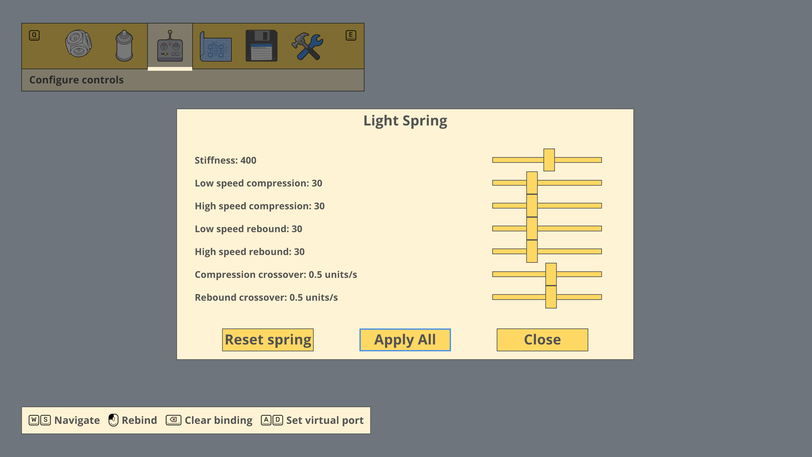

# Mars First Logistics Spring Tuner

Tune your suspension directly in the game's **Configure controls** menu. Adjust stiffness and separate low-speed/high-speed compression and rebound damping for each spring, or copy those settings to matching springs across your vehicle.

Supports **Light, Medium, and Heavy Springs** and **Light, Medium, and Heavy Torsion Springs**, including compressed and extended linear-spring variants.



## Install

You need two downloads: **BepInEx**, which loads mods, and **Spring Tuner**, the plugin itself. You do not need to compile anything or install a development SDK to play.

These instructions target the Windows version of Mars First Logistics, including when it runs through Proton on Linux or Steam Deck. The tested setup uses Proton and BepInEx build 791; native Windows and Steam Deck have not been separately tested.

### 1. Open the game folder

Close the game. In your Steam Library, right-click **Mars First Logistics → Manage → Browse local files**. On Steam Deck, do the file-copying steps in Desktop Mode.

Keep this folder open. It should contain **`Mars First Logistics.exe`** and **`GameAssembly.dll`**. Whenever these instructions say “game folder,” they mean this folder.

### 2. Install BepInEx

Open the [official BepInEx builds page](https://builds.bepinex.dev/projects/bepinex_be) and find build **791**. Download this tested version:

```text
BepInEx-Unity.IL2CPP-win-x64-6.0.0-be.791+b782da4.zip
```

Choose **Unity IL2CPP, Windows x64**. The Windows package is also the correct choice when running this Windows game through Proton. BepInEx 5, Unity Mono, and x86 packages are not suitable for this plugin.

Extract the **contents** of the BepInEx ZIP directly into the game folder. `winhttp.dll` should sit beside `Mars First Logistics.exe`, rather than inside an extra folder named after the ZIP. See the [official IL2CPP installation guide](https://docs.bepinex.dev/master/articles/user_guide/installation/unity_il2cpp.html) for more loader details.

If you already have this BepInEx version installed for another mod, keep that installation and continue to step 3.

### 3. Install Spring Tuner

Get [SpringTuner-BepInEx.zip](dist/SpringTuner-BepInEx.zip) from this repository's `dist` folder. Extract its contents into the same game folder, merging the `BepInEx` folders when asked.

The finished layout should look like this:

```text
Mars First Logistics/
├── Mars First Logistics.exe
├── GameAssembly.dll
├── winhttp.dll
├── doorstop_config.ini
├── dotnet/
├── BepInEx/
│   ├── core/
│   └── plugins/
│       └── SpringTuner/
│           └── MarsFirstLogistics.SpringTuner.dll
└── spring-tuner/
    ├── README.md
    └── launch-game.sh
```

Spring Tuner's ZIP includes the plugin and an optional Linux launcher. **BepInEx is a separate download** and must also be installed.

Upgrading from the old standalone Spring Tuner? Remove that mod's **`version.dll` from the game folder** before launching. The old loader and the BepInEx plugin must not run together. The legacy web panel is no longer used.

### 4. Launch the game

**Windows:** launch Mars First Logistics normally through Steam.

**Linux / Steam Deck using Proton:** open **Properties → General → Launch Options** for the game in Steam and enter:

```sh
WINEDLLOVERRIDES="winhttp=n,b" %command%
```

Then launch through Steam. This tells Proton to load the BepInEx loader included in the game folder. Keep this launch option for future sessions. If you already use custom launch options, incorporate the override into them rather than discarding your existing settings.

The first BepInEx launch can take longer while it generates files needed by the mod. Let it finish loading.

### 5. Check that it worked

Load a vehicle with a spring, enter the vehicle editor, and select **Configure controls**. Hover over the spring and use the configure action shown by the game. You should see the suspension sliders instead of “This part has no controls.”

If the sliders do not appear, open **`BepInEx/LogOutput.log`** in the game folder and look for:

```text
Loading [Mars First Logistics Spring Tuner 2.1.1]
Spring Tuner 2.1.1 loaded
```

The second message has additional text after it. See [Troubleshooting](#troubleshooting) below if either message is missing.

## Tune your suspension

Open a spring in **Configure controls**, adjust its sliders, and close the popup. The settings belong to that individual spring. Return to driving to try the changes.

| Setting | What it changes |
| --- | --- |
| Stiffness | How strongly the spring resists deformation. Higher values make it stiffer. |
| Low-speed compression damping | Resistance while the spring compresses slowly. |
| High-speed compression damping | Resistance while the spring compresses quickly. |
| Low-speed rebound damping | Resistance while the spring returns toward its resting position slowly. |
| High-speed rebound damping | Resistance while the spring returns quickly. |
| Compression speed crossover | The spring movement speed where compression damping transitions between the low- and high-speed values. |
| Rebound speed crossover | The equivalent transition speed for rebound damping. |

**Speed means spring movement speed, not vehicle speed.** For torsion springs, it means rotation speed. Start with small adjustments and change one setting at a time to see its effect.

**Apply All** copies the displayed settings to every spring of the same family on the current vehicle. For example, tuning a Light Spring and choosing Apply All also updates its compressed/extended variants, but leaves Medium Springs, Heavy Springs, and torsion springs alone. The button plays the menu-opening sound.

**Reset spring** restores the selected spring's stock settings. To reset a whole family, reset one spring and then choose Apply All.

Slider edits made during one popup session are grouped into an undo step. Apply All creates its own undo step. Springs you have not tuned retain the game's default behavior.

## Save and load tuned vehicles

Use the game's normal **Saved designs** menu:

1. After tuning, open **Saved designs**.
2. Right-click the desired slot and choose **Save to slot**.
3. To load it later, left-click the slot and choose **Load vehicle**.

Tuning is stored with the design, including each spring's individual settings. Renaming a saved design is also handled. Keep Spring Tuner installed when using and saving tuned vehicles: the base game uses stock physics without the plugin, and saving without it discards the tuning data.

Designs saved by the earlier version that omitted tuning need to be tuned and saved again. That missing data cannot be recovered from the old blueprint.

Multiplayer synchronization is not implemented or tested.

## Update or uninstall

**Update:** close the game, extract the new Spring Tuner ZIP into the game folder, and replace the previous plugin DLL. Keep only one copy of the plugin under `BepInEx/plugins`. Restart the game to load the update; normally you can keep your existing compatible BepInEx installation.

**Uninstall:** close the game and delete `BepInEx/plugins/SpringTuner`. Keep BepInEx if you use other mods. Removing Spring Tuner restores stock spring behavior. Keep copies of tuned designs if you plan to reinstall later, and avoid resaving those copies without the plugin.

## Troubleshooting

| Problem | What to check |
| --- | --- |
| There is no `BepInEx/LogOutput.log`. | Confirm `winhttp.dll` is beside the game EXE and that you extracted the Windows x64 IL2CPP loader. On Proton, check the Steam launch option in step 4. |
| BepInEx starts but Spring Tuner is missing from the log. | Check the plugin DLL's location against the folder layout above. Restart after copying it. |
| A spring still says “This part has no controls.” | Check that both plugin startup messages appear in the log, then look for Spring Tuner errors. Confirm you are selecting one of the supported spring parts. |
| The log reports an unsupported game build. | The plugin checks the game version before patching it. A game update may require an updated Spring Tuner release; reinstalling the same plugin will not bypass that check. |
| Saved settings are missing. | Save again with version 2.1.1 loaded. The log should report `Saving tuning for ... springs in saved design slot ...` and `Restored tuning for ... springs from vehicle data.` Check for persistence warnings if those messages are absent. |

When reporting a problem, include your platform, plugin version, and `BepInEx/LogOutput.log` from the affected session.

### Optional Linux launcher

Launching through Steam with the override above is the simplest setup. The included script is an alternative for a Steam library containing both **Proton - Experimental** and **SteamLinuxRuntime_4** alongside the game. It assumes that specific library layout.

From a terminal in the game folder:

```sh
bash ./spring-tuner/launch-game.sh
```

If the script reports missing Proton/runtime files, use the Steam launch option instead.

## Technical details and development

The remaining sections are for developers and anyone interested in how the mod works.

### Compatibility

Plugin version: **2.1.1**. Tested loader: **BepInEx 6.0.0-be.791+b782da4, Unity IL2CPP, Windows x64**, running under Proton. The supported Unity version is **2022.3.62f2**, with this `GameAssembly.dll` SHA-256:

```text
c687618a07b873008a1b045f39d1d8157de35737efaa7138ccc586026200fdc8
```

Other game builds are rejected before patching. Only articulation physics is supported. Load the plugin at normal BepInEx startup, before vehicles are created.

### Physics and stock values

Linear compression is shortening; rebound is extension. Torsion compression is winding farther from the rest angle, in either direction; rebound is unwinding toward it. Torsion crossover units are **rad/s**; linear crossover units are **game distance units/s**.

Below 90% of the crossover, the low-speed damping coefficient applies. Above 110%, the high-speed coefficient applies. The interval between them blends linearly. This is a two-range damping-coefficient model, not a digressive force-slope model. New samples, long simulation gaps, and invalid timing yield zero shaft speed. Angular wraparound is handled; at rest, the previous direction is retained.

The force/torque cap is `max(original force limit, chosen stiffness)`. Zero stiffness still permits damping. Reset and plugin unload restore the original drive stiffness, damping, and force cap while preserving limits, targets, and mode.

| Type | Stock stiffness | Stock damping |
| --- | ---: | ---: |
| Light Spring | 400 | 30 |
| Medium Spring | 1000 | 60 |
| Heavy Spring | 4000 | 200 |
| Light Torsion Spring | 5000 | 20 |
| Medium Torsion Spring | 20000 | 100 |
| Heavy Torsion Spring | 50000 | 100 |

Input ranges are stiffness 0–100000, damping 0–20000, and crossover 0.001–100. Extreme settings can make the suspension unstable.

### Persistence implementation

Per-part values attach to native vehicle nodes using weak handles. Saved designs and base64 saves use a bounded, versioned JSON trailer with a checksum and topology signature. Native vehicle bytes, names, and control bindings stay unchanged. Loading handles the extra padding from the PNG design format and matches settings by tree position, attachment slot, and part ID. Invalid or mismatched extensions are ignored without preventing the base vehicle from loading.

Copying and duplication carry tuning forward. Undo/redo uses additional snapshots because the game serializes its undo history differently.

### Build and tests

Building requires the **.NET 8 SDK**, BepInEx, and this game's generated interop assemblies. Launch once with BepInEx to generate `BepInEx/interop`. For the following scripts, place this source directory at `<game folder>/spring-tuner` and run commands from the game folder:

```sh
./spring-tuner/build.sh
dotnet run --project spring-tuner/bepinex/Tests/Tests.csproj -c Release
./spring-tuner/install-plugin.sh
```

`build.sh` uses a system `dotnet` or a local `spring-tuner/.dotnet/dotnet` SDK if present. If using the local SDK, substitute that path for `dotnet` in the test command. The installer copies the built plugin into `BepInEx/plugins/SpringTuner`; restart the game afterward.

The build passes with zero warnings/errors. Managed tests cover physics, per-part values, topology validation, corrupt/truncated saves, PNG padding, all seven sliders at 10,001 positions, and vehicle-scoped Apply All selection. Runtime logs confirm the detached integration checks pass and that slot 19 saves and restores tuning for four springs. The native popup and Apply All have also been confirmed in use. Audible confirmation of the new sound, rename/resave behavior, and undo/redo still need dedicated in-game verification.

To run the optional native integration checks, create an empty `spring-tuner/.run-integration-checks` file before launching. Once a spring loads, the checks run on detached copies and write their result to the log. They cover independent nodes, copy/clone, base64, named/unnamed saves with PNG padding, and reset isolation. They do not alter live nodes or disk saves. The request file is consumed once.

Source is in `bepinex/`; investigation notes are in `evidence/`. The previous web-controlled version remains in Git commit `0df54b4`. Its panel and global tuning files have been removed from the current tree. Historical native-mod material remains in `legacy-native/` and `src/`.
